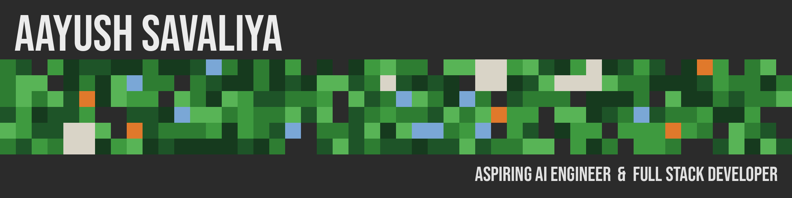
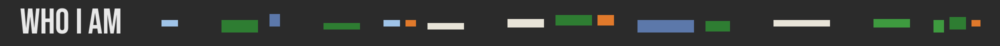
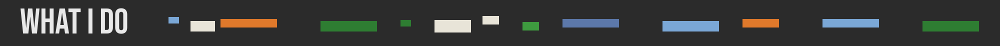
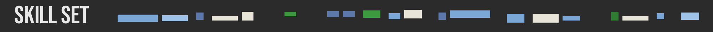
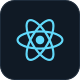
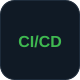
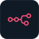
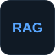
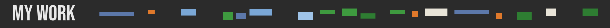
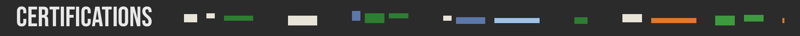

 

<samp>Hey, I'm Aayush — a B.Tech AI & ML student at CHARUSAT University, Ahmedabad, passionate about building software that solves real problems. I work at the intersection of AI agents, LLMs and full-stack development.</samp>

<samp>I build AI-powered web applications and LLM tools — from AI agents and RAG pipelines to APIs with FastAPI and interfaces with React. Currently exploring AI Agents & Automations. </samp>

<samp>200+ Solved LeetCode Problems. 
5 Star on HackerRank (C++).  
</samp>

 

<table align="center">
  <tr>
    <th align="left" width="14%">Languages</th>
      <td align="center" width="12%"> C++</td>
      <td align="center" width="12%"> Python</td>
  </tr>
  <tr>
    <th align="left" width="14%">Full Stack</th>
      <td align="center" width="12%"> React</td>
      <td align="center" width="12%"> FastAPI</td>
      <td align="center" width="12%"> CI/CD</td>
      <td align="center" width="12%"> HTML</td>
      <td align="center" width="12%"> Tailwind</td>
  </tr>
  <tr>
    <th align="left" width="14%">Agentic AI</th>
      <td align="center" width="12%"> LangChain</td>
      <td align="center" width="12%"> LangGraph</td>
      <td align="center" width="12%"> n8n</td>
      <td align="center" width="12%"> RAG</td>
      <td align="center" width="12%"> Vector DB</td>
      <td align="center" width="12%"> Gemini</td>
      <td align="center" width="12%"> Groq API</td>
  </tr>
  <tr>
    <th align="left" width="14%">Tools</th>
      <td align="center" width="12%"> GitHub</td>
      <td align="center" width="12%"> Swagger</td>
      <td align="center" width="12%"> Postman</td>
      <td align="center" width="12%"> VS Code</td>
      <td align="center" width="12%"> Vercel</td>
      <td align="center" width="12%"> Render</td>
      <td align="center" width="12%"> Docker</td>
  </tr>
</table>
 

<table>
  <tr>
    <td width="50%" valign="top">
      <h3>🌐 Anuvaad AI</h3>
      
<i>Multilingual AI-powered PDF understanding and language assistant</i>

      
Breaks language barriers by helping users understand and interact with documents in English, Hindi, and Gujarati through multilingual AI and document-grounded answers.

      <strong>✨ Highlights</strong>
      <ul>
        <li>Retrieval-Augmented Generation (RAG) for document-grounded responses</li>
        <li>PDF parsing, layout extraction, OCR, and page-aware chunking</li>
        <li>Semantic and hybrid retrieval for relevant passages</li>
        <li>Source citations and document references</li>
      </ul>
      <strong>🧰 Built with</strong>
      

        <code>FastAPI</code>
        <code>React</code>
        <code>TypeScript</code>
        <code>Tailwind CSS</code>
        <code>LangChain</code>
        <code>Groq</code>
        <code>Docling</code>
        <code>Qdrant</code>
      

      
    </td>
    <td width="50%" valign="top">
      <h3>🎤 InterviewIQ</h3>
      
<i>AI-powered interview performance analyzer and career advisor</i>

      
Helps candidates prepare for technical and behavioral interviews through interactive mock sessions, AI-generated follow-up questions, performance evaluation, and personalized feedback.

      <strong>✨ Highlights</strong>
      <ul>
        <li>AI-powered mock interviews and dynamic follow-up questions</li>
        <li>Voice-based interaction and speech-to-text processing</li>
        <li>Answer evaluation for relevance, clarity, and completeness</li>
        <li>Interview performance scoring and personalized feedback</li>
      </ul>
      <strong>🧰 Built with</strong>
      

        <code>FastAPI</code>
        <code>React</code>
        <code>Tailwind CSS</code>
        <code>PostgreSQL</code>
        <code>JWT</code>
        <code>LLM APIs</code>
        <code>NLP</code>
      

      
    </td>
  </tr>
</table>

  

### ✨ Stay tuned — more projects coming soon!
<table align="center">
  <tr>
    <th align="center">LinkedIn</th>
    <th align="center">Gmail</th>
    <th align="center">LeetCode</th>
    <th align="center">HackerRank</th>
  </tr>
  <tr>
    <td align="center"></td>
    <td align="center"></td>
    <td align="center"></td>
    <td align="center"></td>
  </tr>
</table>
 

