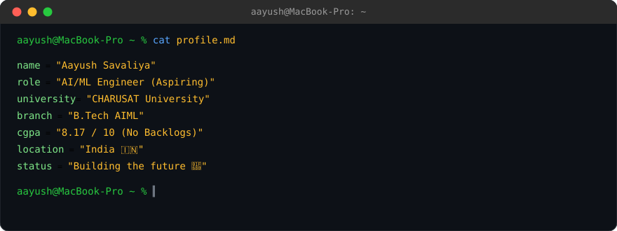
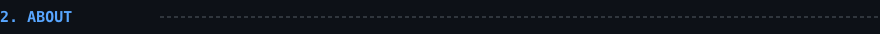
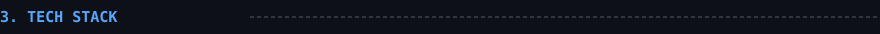
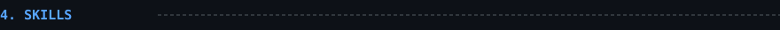
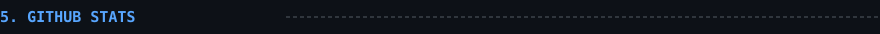
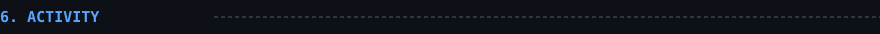
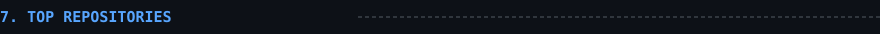
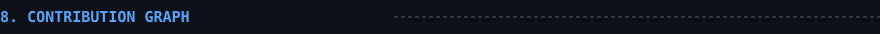
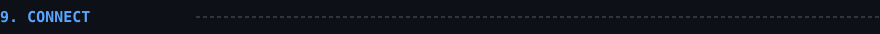

<p align="center">
  
</p>

<br/>



```
Passionate about Artificial Intelligence and building real-world impactful solutions.
Currently focused on ML, LLMs, and Full-Stack Development.
Goal: To become an AI/ML Engineer and build AI products that scale.
```

<br/>



|  |  |
|---|---|
| 🧩 **Frontend** | `React` `Tailwind CSS` `JavaScript` `Vite` |
| ⚡ **Backend** | `FastAPI` `Python` |
| 🗄️ **Database** | `PostgreSQL` `MongoDB` |
| 🧠 **AI/ML** | `Python` `TensorFlow` `Keras` `Scikit-learn` |
| 🛠️ **Tools** | `Git` `GitHub` `Docker` `Postman` `VS Code` |
| ☁️ **Cloud** | `Render` `Vercel` `Neon` `GitHub Actions` |
| 🔌 **Others** | `REST APIs` `WebSockets` `JWT` `OAuth` |

<p align="center">
  
</p>

<br/>



```
Python            ████████████████████░░  90%
Machine Learning  █████████████████░░░░░  85%
Deep Learning     █████████████████░░░░░  85%
Data Analysis     ██████████████░░░░░░░░  70%
FastAPI           █████████████████░░░░░  85%
React.js          ████████████████░░░░░░  80%
SQL / DBMS        ████████████████░░░░░░  80%
LLM / NLP         ██████████████░░░░░░░░  70%
Docker            ████████████░░░░░░░░░░  60%
System Design     █████████████░░░░░░░░░  65%
```

<br/>



<p align="center">
  
  
</p>

<p align="center">
  
</p>

<br/>



<p align="center">
  
</p>

<br/>



<p align="center">
  
  
</p>

<p align="center">
  
  
</p>

<br/>



<p align="center">
  
</p>

<br/>



<p align="center">
  <a href="mailto:youremail@example.com"></a>
  <a href="https://linkedin.com/in/yourprofile"></a>
  <a href="https://github.com/Aayushh910"></a>
</p>
